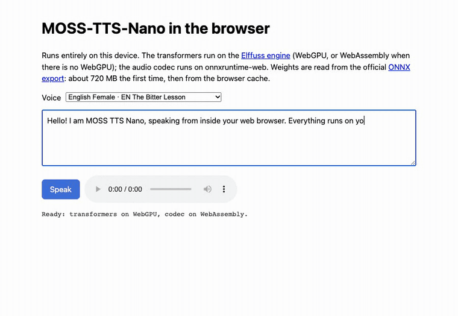

# MOSS-TTS-Nano in the browser (WebGPU)

A single HTML page that runs MOSS-TTS-Nano entirely on the user's device: no Python, no install, no server-side inference.



The same recording with its sound: [`demo.mp4`](demo.mp4).

- The global and local transformers run on the [Elffuss engine](https://github.com/utopia-ia/elffuss-engine) (Apache-2.0): on the GPU through WebGPU, or on the CPU through WebAssembly SIMD when WebGPU is not available.
- The audio decoder runs the official `MOSS-Audio-Tokenizer-Nano-ONNX` graph on onnxruntime-web.
- Weights, tokenizer, built-in voices and generation defaults are read from the official Hugging Face repositories (`MOSS-TTS-Nano-100M-ONNX` and `MOSS-Audio-Tokenizer-Nano-ONNX`) at pinned revisions. Nothing is converted or re-hosted.

## Run

```bash
cd examples/web_webgpu
python3 -m http.server 8000
```

Open <http://localhost:8000>, pick one of the 18 built-in voices, type a text and press **Speak**. The first run downloads about 720 MB from Hugging Face; later runs read it from the browser cache. Add `?cpu=1` to the URL to try the WebAssembly path on a machine that has WebGPU.

Any static file server works; the page needs no special headers.

## What to expect

With the same request rows and the same uniform random numbers, the engine produces the same audio frames as `onnx_tts_runtime` with the fixed sampled frame (checked on 24 frames). The sampling follows the exported graph: repetition penalty 1.2, temperature 0.8, top-k 25, top-p 0.95. The frames can differ in a near-tie of the draw, where the last bit of a logit decides.

Measured on the same machine and page, prefill of a voice-cloning request plus 24 frames:

| Path | Relative speed |
|---|---|
| onnxruntime-web, WebAssembly, 1 thread | 1× |
| onnxruntime-web, WebAssembly, 4 threads | 2.6× |
| Elffuss engine, WebAssembly, 1 thread | 1.35× |
| Elffuss engine, WebGPU | 5.2× |

## How it works

`index.html` builds the request rows the way the official runtime does (user prefix, the voice's prompt codes, the text's SentencePiece ids, the assistant prefix), runs the engine's `generaTramasGPU` (WebGPU) or `genera` (CPU) to get the frames, and decodes them with `moss_audio_tokenizer_decode_full.onnx` into 48 kHz stereo. Text is split one sentence per chunk (at most 75 tokens): with several sentences in one chunk the model now and then ends the speech at the first full stop.

Pinned versions, all at the top of the page script: the engine (`utopia-ia/elffuss-engine`), the SentencePiece tokenizer (`utopia-ia/elffuss-ai`, `sdk/audio/spm.js`), onnxruntime-web 1.30.0 and the two Hugging Face revisions.
